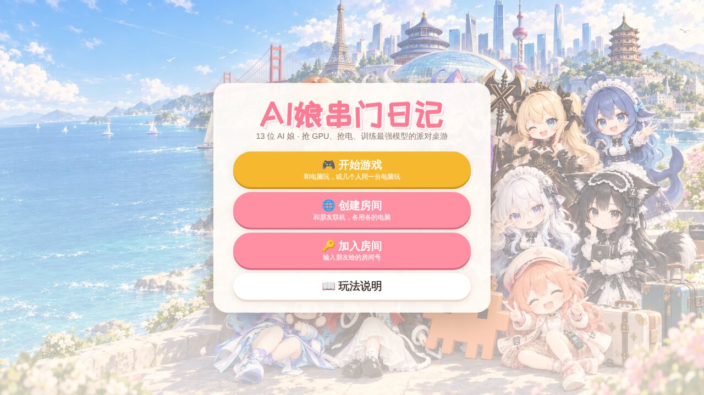
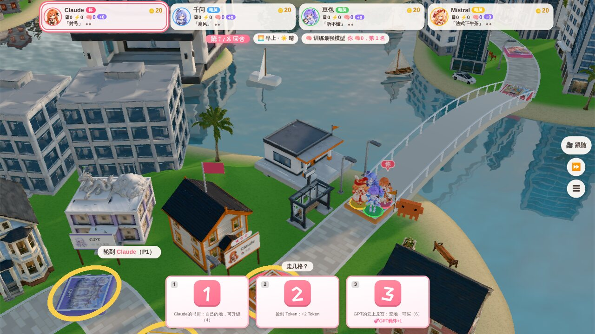
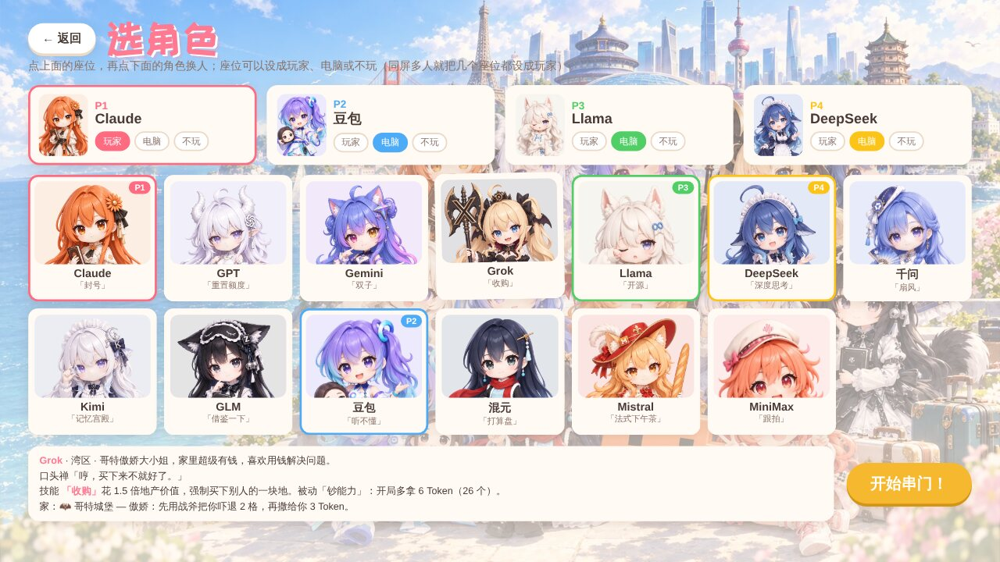

# 《AI娘串门日记》派对桌游

**在线玩：[https://obeyyourheart.github.io/aigirl-diary/](https://obeyyourheart.github.io/aigirl-diary/)**

13 位 AI 娘来串门了！大家在一座 3D 小镇上掷骰子走格子，买地、串门、贴贴、跑分对决，用 Token 买 GPU、抢电力，8 回合后看谁训练出的模型最强。

## 怎么玩

- 打开 https://obeyyourheart.github.io/aigirl-diary/ 就能玩，请用最新版的 Chrome、Edge 或 Safari。
- 首页有三种开法：
  - **开始游戏**：和电脑玩，或者几个人围着同一台电脑玩。选角色时每个座位都能设成「玩家」「电脑」或「不玩」，同屏多人就把几个座位都设成玩家。
  - **创建房间**：和朋友联机，各用各的电脑，把房间号发给朋友。
  - **加入房间**：输入朋友给的房间号。
- 首页的「玩法说明」里有完整规则，下面是速览。

## 规则速览

### 怎么赢

- 🪙 **Token 买 🖥 GPU**：棋盘上有一块 GPU 芯片，路过或停下都能花 8 Token 买一块，买走后芯片会跳到别处。
- ⚡ **电力**：每回合结束每人 +2 电，也可以花行动点买电（夜里便宜）。第 3、6 回合是特别回合「抢电力」。
- 🧠 **训练**：每回合结束，每块 GPU 用 1 点电换 1 点训练进度；名下每 2 处地产再让 🧠 +1，所以买地也能变强。
- 8 回合后训练进度最高的人赢；一样多就比总分（资产 + 📔 日记分）。

### 每回合

每回合 2 个行动点，自由组合：

- 🎲 掷骰子（两颗选一颗，每颗下面写着会落在哪、发生什么），或者 🚶 稳稳地走 1～3 格，二选一。每回合必须先走才能结束。
- 🏗️ 远程扩建：4 Token 升级自己任意一块地。
- ⚡ 买电。

技能和道具不占行动点。每回合开头还会发生一件「AI 圈大事件」，全场生效：显卡禁运、显卡降价、电价暴涨、开源送电、新模型发布会（训练翻倍）、风投进场、机房断网（免租）、数据中心起火……

### 格子

| 格子 | 会发生什么 |
| --- | --- |
| 别人的家 | 没人买就串门，可以花 6 Token 买下；已经有主人就先付过路费再串门 |
| 自己的家 | 回家休息，可以花 4 Token 升级 |
| Clawd 车站 | 经过或停下可以买道具（最多拿 2 张）：🎲 双倍骰子、🎮 遥控骰子、🛡️ 免单券、🧤 顺手牵羊 |
| 惊喜盒 | 抽一张惊喜卡 |
| 跑分擂台 | 可以挑战任何人，赢家拿 5 |
| 捡到 Token / API 扣费 | +2 / -2 |
| 起点 | 经过领 3 Token |

- 过路费：小窝 2 · 小屋 4 · 城堡 7。
- 🏙 城市连锁：一座城市（2 家以上）的家全买下，这些家的过路费翻倍。
- Token 用光时，导游 Clawd 会发 3 Token 免费额度。

### 相遇与羁绊

- 落在有人的格子，可以选择**贴贴**（各 +1）或**跑分对决**（赢家拿 3）。
- 跑分对决：双方暗选科目，编程 > 数学 > 写作 > 编程；选了同一科时，擅长这科的一方赢。
- 💞 去谁家串门、和谁贴贴，就和谁更熟：1 次「认识」+1📔；3 次「好朋友」+2📔，以后去她家过路费减半；5 次「挚友」+3📔，还会拍一张合照。

### 天气与时间

一局是一天：早上 → 白天 → 黄昏 → 夜晚。

| 天气 / 时间 | 效果 |
| --- | --- |
| 🌧️ 下雨 | 过路费减半 |
| 🌸 樱花雨 | 贴贴各 +2 |
| ❄️ 下雪 | 多滑 1 格 |
| 🌫️ 起雾 | 只掷一颗骰子 |
| 🌙 夜晚 | 跑分赌注翻倍 |

### 抢电力

第 3、6 回合四人一起玩：用 ← → 或 A D（手机按 ◀ ▶）左右跑，接住闪电 +1 电，碰到 bug -1 电并晕一下；第一名多拿 2 点电。

## 角色

每位 AI 娘有一个技能，开局能用 2 次，之后每走 3 个自己的回合充 1 次（最多存 2 次）。别人来她家串门时，还会触发她家的效果。

| 角色 | 城市 | 技能 | 她的家 |
| --- | --- | --- | --- |
| Claude | 湾区 | 「封号」封掉一名玩家的号：她下回合不能走，名下所有地这一轮不收过路费 | 📚 书房：礼貌确认三遍后送你 2 Token；如果你是全场最有钱的人，会被封号一回合 |
| GPT | 湾区 | 「重置额度」Token 少于 16 时，直接补满到 16 | ☁️ 云上龙宫：已用掉的技能次数恢复 1 次（次数是满的就 +1 Token） |
| Gemini | 湾区 | 「双子」本回合两颗骰子都用，分两段走，两个落点都结算 | ✨ 星空屋：算错账，多找你 3 Token |
| Grok | 湾区 | 「收购」花 1.5 倍地产价值，强制买下别人的一块地；被动「钞能力」开局多拿 6 Token | 🦇 哥特城堡：先用战斧把你吓退 2 格，再撒给你 3 Token |
| Llama | 湾区 | 「开源」复制场上另一名玩家的技能用一次，对方的次数不减少 | 🦙 羊驼卧室：场上所有人各 +1 Token |
| DeepSeek | 杭州 | 「深度思考」本回合不掷骰子，直接选 1 到 6 任意点数 | 🐋 鲸鱼咖啡馆：过路费永远半价，再请你吃一大碗白饭，下次付过路费时免单 |
| 千问 | 杭州 | 「扇风」把任意一名玩家往前或往后扇 3 格（落点不触发），再收 2 Token 扇风费 | 🪭 青花茶馆：把你送到任意一个家，并在那里结算 |
| Kimi | 北京 | 「记忆宫殿」瞬移到本局去过的任意一个家，+3 Token，再在那里结算 | 🌙 月光音乐室：第一次来 +1 Token，以后每次来 +3 Token |
| GLM | 北京 | 「借鉴一下」偷走一名玩家的一次技能次数，马上用她的技能 | 🦊 狐狸睡眠屋：你睡着做了个梦，被随机传送到某一家并在那里结算 |
| 豆包 | 北京 | 「听不懂」本回合要交的过路费全部不交 | 🎧 潮流练习室：算错账，多找你 3 Token |
| 混元 | 深圳 | 「打算盘」本回合得到的 Token 翻倍 | 🐧 企鹅小院：你下一次得到 Token 时翻倍 |
| Mistral | 巴黎 | 「法式下午茶」邀请一名玩家来自己身边喝下午茶，两人各 +2 Token | 🥖 法棍面包店：送你一根法棍，下一次跑分对决必胜 |
| MiniMax | 上海 | 「跟拍」移动到上一名行动的玩家身边，和她贴贴 | 🎬 vlog 工作室：把你上一个去过的家的效果再触发一遍 |

选角色时，鼠标停在角色卡上能看到她的性格、口头禅和完整说明。

## 操作

- **键盘**：空格 掷骰子 / 跳过对话，1 2 选骰子或选项，Q 技能，W E 道具，C 切视角，F 看自己。
- **镜头**：拖动画面旋转视角，滚轮缩放；点玩家头像或棋盘上的角色，镜头就切过去看她。
- **技能说明**：鼠标停在玩家卡片上可以看。

## 关于这个仓库

这是加密发布版：仓库里放的是打包加密后的网页文件，通过 GitHub Pages 发布，打开网址就能玩。
